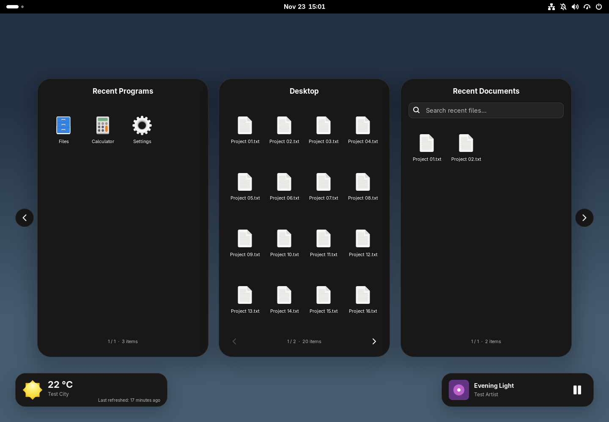

# Grand Central Desktop

Grand Central Desktop is a customizable desktop carousel with application and file launchers, a browser, a calculator, a note, and calendar, weather, and media widgets.

## Quick start

Use GNOME Shell 49, 50, or 51. The installer requires Python 3 and GLib’s `glib-compile-schemas` command. The embedded browser also requires GTK 3, WebKit2GTK 4.1, and Xwayland. See the [dependency details](Gnome-extension/README.md#dependencies) for package names.

1. Clone this repository or download its source, then open a terminal in the checkout.
2. Install the extension for your user account.

   ```sh
   cd Gnome-extension
   python3 tools/install.py
   ```

3. Enable **Grand Central Desktop** in the GNOME Extensions app. If it does not appear after a first install, sign out and back in.

Right-click the desktop and choose **Grand Central Desktop Settings** to customize it. The installer copies the build into GNOME’s extensions directory. The [installation guide](Gnome-extension/docs/INSTALLATION.md) shows where it goes and how to update an existing installation.

## Screenshots

Captured in an isolated GNOME session with fictional files, events, weather, media, and a local demo webpage.



- [Calendar with an ongoing event](Gnome-extension/docs/screenshots/calendar.png)
- [Browser and calculator](Gnome-extension/docs/screenshots/browser-and-calculator.png)

## Documentation

- [GNOME extension](Gnome-extension/README.md)
- [Installation and build locations](Gnome-extension/docs/INSTALLATION.md)
- [Standalone Windows specification](Gnome-extension/SPEC-windows.md)
